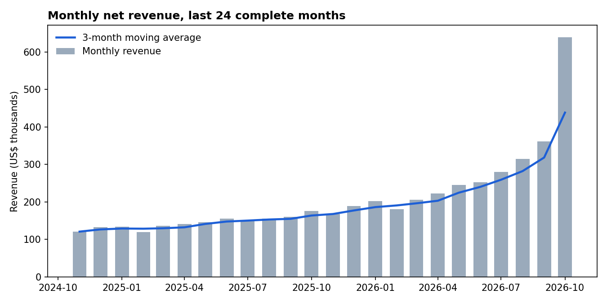
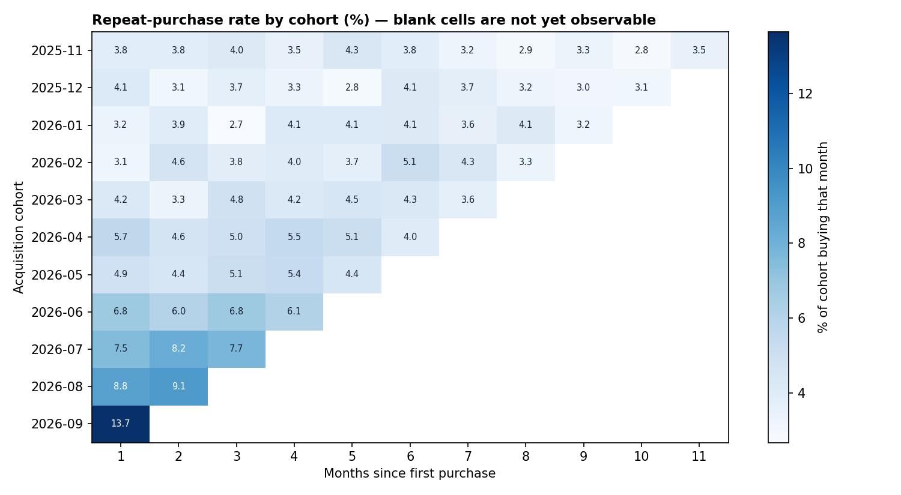
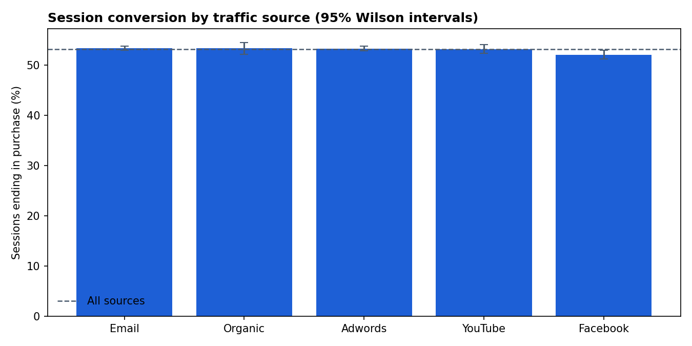
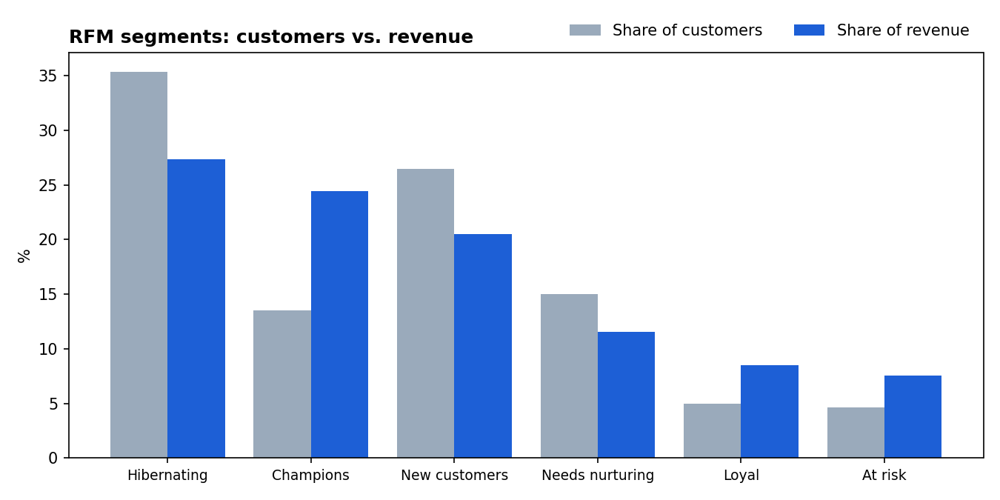
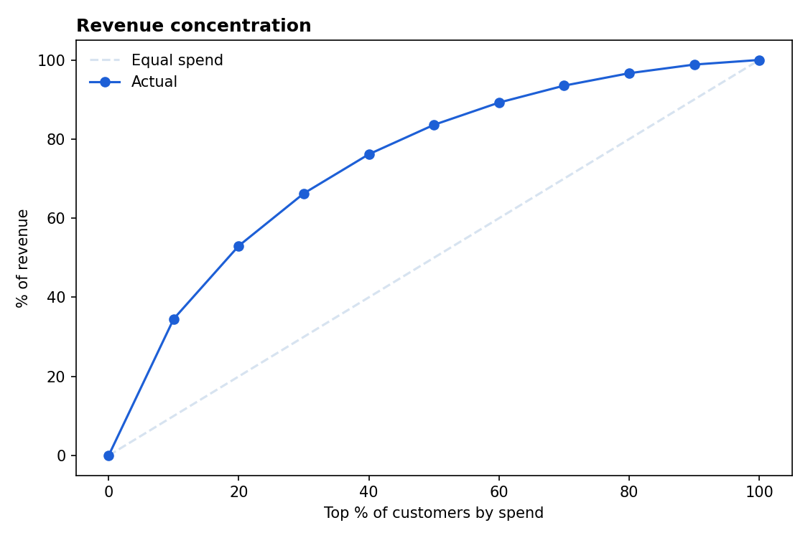
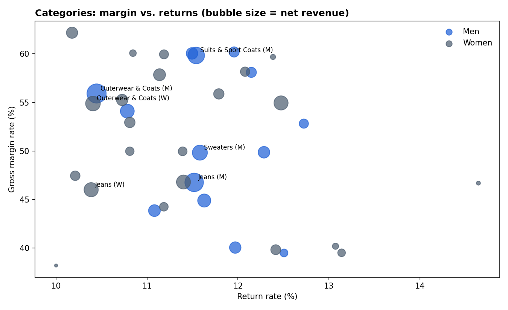

# E-commerce Analytics in SQL — Growth, Retention, Funnel and Customer Value

[](https://github.com/abatista346/ecommerce-sql-analytics/actions/workflows/tests.yml)

> SQL-first analysis of an online fashion retailer on **BigQuery**: monthly KPIs, acquisition-cohort retention, a session funnel by traffic source with significance testing, RFM segmentation, revenue concentration and category margins. Every query is unit-tested in CI by transpiling it to DuckDB and running it against synthetic data.

## Business Questions

A head of e-commerce asks five things:

1. **Are we growing?** Monthly revenue, orders, average order value, month-over-month and year-over-year growth.
2. **Do new customers come back?** Repeat-purchase rate by monthly acquisition cohort.
3. **Which traffic sources convert?** Product view → cart → purchase, by source — and whether the differences are real or noise.
4. **Who drives revenue?** RFM segments and how concentrated revenue is among top customers.
5. **Which categories make money?** Gross margin and return rate by category, ranked within department.

## Data Source

[theLook eCommerce](https://console.cloud.google.com/marketplace/product/bigquery-public-data/thelook-ecommerce), a public BigQuery dataset (`bigquery-public-data.thelook_ecommerce`) published by Google with users, orders, order items, products and web events for a fictional clothing store. The data is synthetic and regenerated continuously, so every query uses a fixed cut-off date for reproducible results, and the data-quality query checks for rows dated after it.

## SQL Techniques

| Query | What it answers | Techniques |
|---|---|---|
| [`00_data_quality.sql`](sql/00_data_quality.sql) | Can the data be trusted? | Scalar subqueries, `NOT EXISTS` anti-join, `COUNTIF` |
| [`01_monthly_kpis.sql`](sql/01_monthly_kpis.sql) | Are we growing? | CTEs, `LAG` with a named `WINDOW`, moving average and running total frames, `SAFE_DIVIDE` |
| [`02_cohort_retention.sql`](sql/02_cohort_retention.sql) | Do customers come back? | First-purchase cohorts over the full history, `DATE_DIFF` by month |
| [`03_funnel_by_source.sql`](sql/03_funnel_by_source.sql) | Which sources convert? | Session-level pivot with conditional aggregation, strict funnel stages, `ROLLUP` totals |
| [`04_rfm_segments.sql`](sql/04_rfm_segments.sql) | Who are our best customers? | `NTILE` scoring, segment rules, shares with `SUM(...) OVER ()` |
| [`05_revenue_concentration.sql`](sql/05_revenue_concentration.sql) | How concentrated is revenue? | Decile ranking, cumulative share with window frames |
| [`06_category_performance.sql`](sql/06_category_performance.sql) | Which categories make money? | Join to products, `RANK() OVER (PARTITION BY ...)`, share within department |

**Design choices worth noting**

- **Revenue** excludes cancelled and returned items; the **return rate** is computed over non-cancelled items, since only sold items can be returned.
- **Cohorts** use each customer's first purchase across the *full* history, so an old customer never shows up as "new" in a recent cohort. Months a cohort has not reached yet are shown as blank, not as 0% retention.
- **RFM frequency** uses fixed buckets (1, 2, 3, 4+ orders) instead of `NTILE`: most customers have one or two orders, and `NTILE` would assign identical order counts to different scores arbitrarily.
- **Funnel stages are strict**: a session counts as "cart" only if it also viewed a product, so the funnel can only narrow.

## Approach

1. **SQL** (`sql/`) — the analysis logic, in BigQuery Standard SQL.
2. **Runner** (`src/run_analysis.py`) — executes each query on BigQuery, saves results to `outputs/`, draws the charts, tests whether conversion differs by traffic source (χ² test of independence, Wilson intervals), and writes the *Results* section below from the computed numbers.
3. **Tests** (`tests/`) — each SQL file is transpiled to DuckDB with [sqlglot](https://github.com/tobymao/sqlglot) and run against a synthetic database with theLook's schema. The tests check the logic against independent pandas calculations (e.g. monthly revenue totals, cohort sizes) and structural rules (funnel never widens, shares sum to 100%, cohort month 0 is always 100%).

## Tech Stack

SQL (BigQuery, DuckDB), Python, pandas, SciPy, statsmodels, matplotlib, sqlglot, pytest, GitHub Actions

<!-- RESULTS:START -->

## Results (data through October 2026)

### Data quality

- 124,452 orders in the dataset, none dated after the cut-off.
- 0 orders without items, 0 duplicate item ids, 0 orders without a user.
- 15.0% of items are cancelled and 10.0% returned; both are excluded from revenue.

### Growth

Net revenue over the last 12 months was **US$3,259,634**, +89% versus the prior 12 months. That headline is inflated by the final months: the last month alone is 3.3× the median month before it. theLook is synthetic and its most recent months are much denser than the rest, so this jump is most likely an artifact of how the data is generated rather than a business trend. Excluding the last 3 months, revenue grew **+58%** year over year, the better estimate of the underlying trend.



### Retention

Across the last 12 acquisition cohorts, a median of **4.9%** of new customers buy again in their second month (range 3.1%–13.7%). Retention is the weakest part of the business: most revenue depends on acquiring new buyers. The newest cohorts show much higher rates; this coincides with the same end-of-series jump in orders, so it should not be read as improving loyalty without more months of data.



### Conversion by traffic source

Session conversion ranges from **52.02% (Facebook)** to **53.33% (Email)**. The differences are **not** statistically significant (χ² = 8.0, df = 4, p = 0.09), so channel budget should not be reallocated on conversion alone.



### Who drives revenue

- The top 10% of customers generate **34.5%** of revenue, and the top 20% generate **53.0%**.
- **Champions** (recent, repeat buyers) are 13.5% of customers but 24.4% of revenue; **At risk** customers (repeat buyers who have gone quiet) hold 7.6% of revenue.




### Categories

Highest margin rate: **Blazers & Jackets** (62.2%). Highest return rate: **Jumpsuits & Rompers** (14.6%).



### Recommendations

1. **Retention before acquisition.** With a median second-month repeat rate of 4.9%, a post-purchase program aimed at first-time buyers has more room to grow revenue than further acquisition spend. Test it with a randomized holdout before scaling.
2. **Win back the *At risk* segment** first: these customers have already bought more than once, so reactivating them is cheaper than converting new ones.
3. **Do not reallocate channel budget on conversion rate alone**: the differences between sources are within sampling noise.

<!-- RESULTS:END -->

## Architecture

```
sql/                      <- one file per business question (BigQuery Standard SQL)
src/
  queries.py              <- renders, runs (BigQuery) and transpiles (DuckDB) the SQL
  run_analysis.py         <- runs every query, charts, significance test, README section
tests/
  synthetic_thelook.py    <- synthetic DuckDB database with theLook's schema
  test_sql.py             <- every query checked against pandas and structural rules
  test_analysis.py        <- analysis helpers and an end-to-end dry run of the report
outputs/
  *.csv                   <- query results
  figures/                <- charts used in this README
```

## Setup

1. `pip install -r requirements.txt`
2. Authenticate with Google Cloud: `gcloud auth application-default login`. Any Google Cloud project works, including a free [BigQuery sandbox](https://cloud.google.com/bigquery/docs/sandbox); the queries scan well under the 1 TB monthly free tier.
3. `python src/run_analysis.py --project YOUR_GCP_PROJECT` (optionally `--analysis-end 2026-11-01`, the exclusive cut-off date)

Or run everything in the browser: [](https://colab.research.google.com/github/abatista346/ecommerce-sql-analytics/blob/main/notebooks/run_on_bigquery.ipynb) — set your project ID in the first cell.

To rebuild the charts and this README from the CSVs already in `outputs/` without querying BigQuery again: `python src/run_analysis.py --from-outputs`.

Run the tests with `pytest` — they need neither BigQuery nor credentials.

## Limitations and Next Steps

1. **Synthetic data.** theLook is generated, so patterns such as seasonality are weaker than in a real store; the value here is in the method and the SQL.
2. **No marketing cost data.** Conversion by source says nothing about return on ad spend; a real channel decision needs cost per session.
3. **Next:** model time-to-second-purchase with survival analysis (Kaplan–Meier by acquisition channel), and move the queries into dbt models with schema tests.
